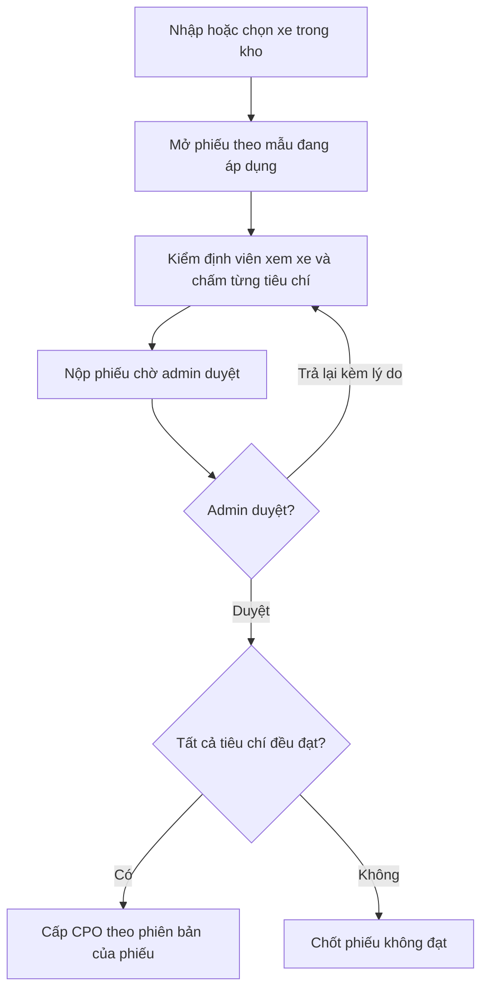
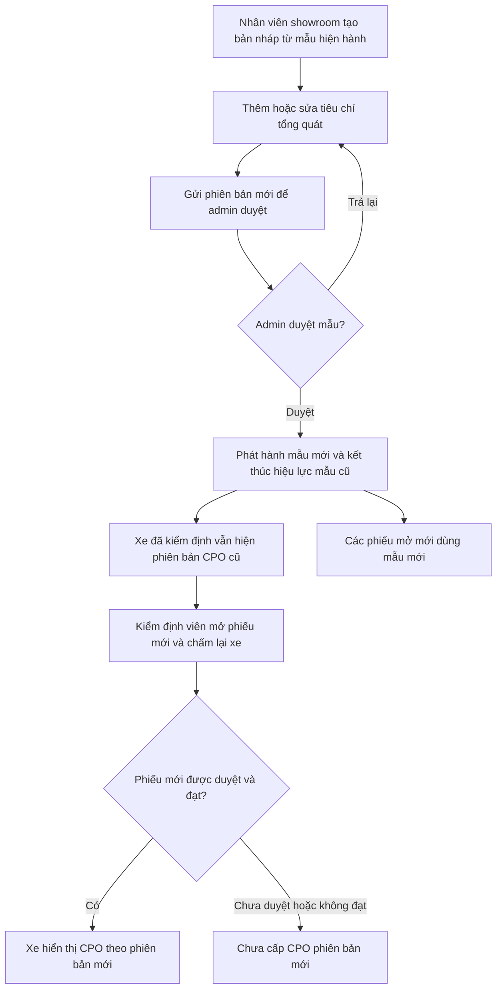
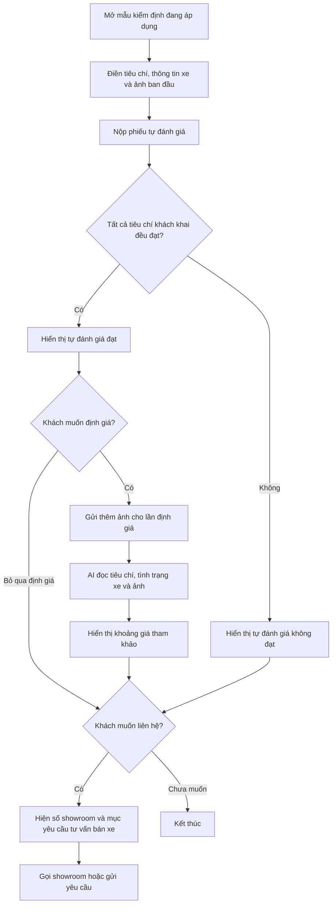
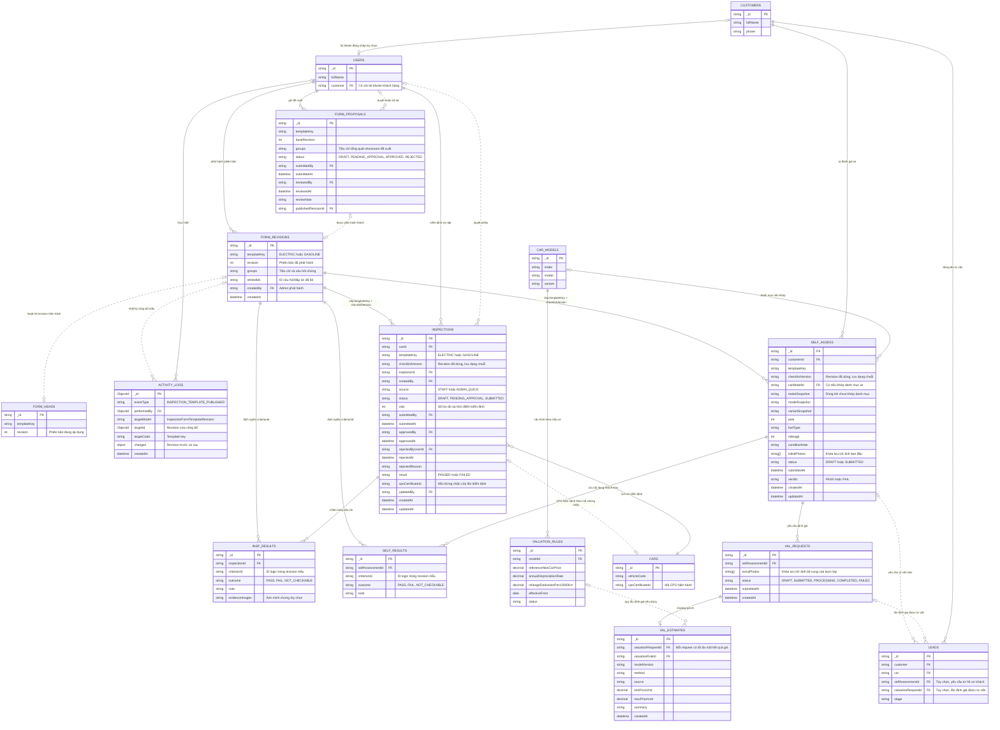

# ERD đề xuất cho ba luồng kiểm định CPO

**PENDING HUMAN REVIEW** · ERD mục tiêu để xem trước; chưa áp dụng vào schema/code.

Đây là mô hình mục tiêu đối chiếu với database TrustCar hiện tại, chưa phải schema đã triển khai. ERD có **16 collection tổng cộng**: 10 collection hiện có được giữ hoặc điều chỉnh, 6 collection mới, với **27 quan hệ logic**. Các bộ tiêu chí nằm nhúng trong bản revision hiện có, không tách thành collection item riêng. `cars.cpoCertificateId` tiếp tục là mã CPO hiện hành; không thêm con trỏ trùng. Các trường và collection cần thay đổi được giải thích sau sơ đồ.

**Revision đang áp dụng** cho biết tiêu chí dùng khi tạo phiếu mới. Phiếu kiểm định và tự đánh giá đều giữ liên kết đến revision đã dùng. Xe giữ CPO v1 cho đến khi lần kiểm định showroom theo revision mới được duyệt và đạt. Tự đánh giá của khách không cấp chứng nhận CPO.

## Luồng 1 · Showroom nhập xe và kiểm định

- Phiếu giữ `carId` để lấy dữ liệu nhận dạng xe từ `cars`; chỉ lưu số km đo tại lần kiểm định. Mỗi tiêu chí có một dòng trong `inspection_results` gồm **Đạt**, **Không đạt** hoặc **Chưa kiểm tra được**, kèm ghi chú/ảnh khi cần.
- Người kiểm định nộp; admin khác người nộp duyệt hoặc trả lại. Khi đạt, phiếu và `cars.cpoCertificateId` được cập nhật trong cùng giao dịch. Không thêm currentInspectionId thứ hai. Xe có nhiều lần kiểm định nhưng tối đa một phiếu đang mở.

## Luồng 2 · Showroom đề xuất mẫu, admin duyệt và xe nâng phiên bản

Ví dụ, admin phát hành mẫu **v2** có thêm tiêu chí thân vỏ. Xe A có phiếu đạt theo **v1** nên vẫn hiển thị **CPO v1**. Kiểm định viên mở phiếu mới theo **v2** và điền từng tiêu chí cho xe A. Sau khi phiếu được duyệt và đạt, chứng nhận hiện hành của xe A chuyển sang **CPO v2**. Phiếu v1 vẫn tra được trong lịch sử.

Bản nháp/gửi duyệt nằm trong `inspection_form_template_proposals`; revision phát hành giữ bất biến trong `inspection_form_template_revisions`, còn `inspection_form_template_heads` trỏ tới revision đang áp dụng. Admin trả đề xuất về `DRAFT` hoặc duyệt để tạo revision mới, cập nhật head và ghi sự kiện vào `activity_logs` trong cùng giao dịch. Phiếu cũ giữ cặp `templateKey + checklistVersion` nên vẫn hiển thị CPO theo revision đã qua kiểm định.

[Xem cách backend ghi dữ liệu công bố mẫu vào nhật ký chung](../../../src/infra/inspection/formTemplateRepository.js).

## Luồng 3 · Khách tự đánh giá, định giá AI và yêu cầu tư vấn

- Khách trả lời **cùng bộ tiêu chí đang áp dụng** và tự khai dữ liệu như hãng, dòng, năm, số km và tình trạng xe. Xe khách có thể chưa có hồ sơ trong kho. Kết quả **tự đánh giá đạt** không cấp mã chứng nhận. Chứng nhận CPO nằm ở luồng showroom. Theo luồng mô tả, chỉ kết quả đạt mới đi tiếp sang định giá. Khách có kết quả không đạt vẫn có thể gửi yêu cầu tư vấn bán xe; đây là chính sách được đưa ra để bạn review.
- Khóa `self_assessments.initialPhotos[]` khi khách nộp phiếu. Khi khách chọn định giá, tạo lượt và khóa `valuation_requests.extraPhotos[]` khi gửi. AI dùng dữ liệu đã nộp, kết quả từng tiêu chí, ảnh ban đầu và ảnh bổ sung. Một lần định giá lưu tối đa một kết quả giá tham khảo. Nếu xử lý lỗi, khách có thể thử lại trên cùng bộ đầu vào. Nếu thay ảnh sau khi đã nộp, tạo lần định giá mới.
- Số điện thoại đọc từ cấu hình liên hệ của showroom. Khi khách gửi yêu cầu tư vấn, hệ thống ghi một `lead` có liên kết đến phiếu tự đánh giá. Thao tác xem số hoặc bấm gọi phục vụ liên hệ trực tiếp.

## ERD mục tiêu để review hoặc dán vào draw.io

Sao chép khối bắt đầu bằng `erDiagram` vào **Arrange → Insert → Mermaid**. Sơ đồ gồm collection hiện có được giữ/điều chỉnh và collection mới đề xuất. Quan hệ đến các tiêu chí nhúng là tham chiếu logic bằng `criterionId`, không phải ObjectId FK.

## Quy tắc giữ các bảng nhất quán

### Collection hiện có được giữ hoặc điều chỉnh

| Collection hiện tại | Trường hiện có liên quan | Mục tiêu sau khi áp dụng ERD |
| --- | --- | --- |
| `inspection_form_template_revisions` | `templateKey`, `revision`, `groups`, `retiredIds`, `createdBy`, `createdAt` | Giữ nguyên mô hình revision bất biến và danh sách tiêu chí nhúng. Phiếu giữ `templateKey + checklistVersion` để chọn đúng revision; không sao chép toàn bộ `groups` lên từng phiếu mới. |
| `inspection_form_template_heads` | `templateKey`, `revision` | Giữ. Mỗi loại mẫu ELECTRIC/GASOLINE có một head xác định revision đang áp dụng. |
| `activity_logs` | `eventType`, `performedBy`, `targetModel`, `targetId`, `targetCode`, `changes`, `createdAt` | Dùng chung nhật ký hệ thống. `targetId` trỏ đến revision vừa công bố. `changes` giữ số phiên bản trước và sau. |
| `inspectionrecords` | `carId`, `inspectorId`, `status`, `source`, `templateKey`, `checklistVersion`, người nộp/duyệt, `odo`, `result`, `cpoCertificateId`, thời gian | Giữ collection/lịch sử và trạng thái duyệt. Phiếu mới chỉ giữ dữ liệu đầu, người thực hiện, số km đo và kết luận. Bỏ khỏi đường ghi mới dữ liệu xe lặp, snapshot checklist, mảng answers/groups/ảnh và tiêu chí nhúng; kết quả tiêu chí chuyển sang `inspection_results`. Trường lịch sử cũ vẫn được đọc theo schema legacy. |
| `cars` | `vehicleCode`, `cpoCertificateId` | Giữ mã CPO duy nhất hiện tại. Hãng, model, variant, năm và màu tiếp tục đọc từ xe. Không thêm `currentInspectionId`; API hiện tìm hồ sơ chứng nhận theo `carId + cpoCertificateId`. |
| `users` | `_id`, danh tính tài khoản | Giữ làm người đề xuất/duyệt mẫu, kiểm định viên và admin duyệt phiếu. |
| `customers` | `_id`, `fullName`, `phone`, email và thông tin CRM | Giữ danh tính người tạo hồ sơ tự đánh giá. Chưa có account/customer mapping nào được tự giả định trong ERD này. |
| `leads` | `customer` bắt buộc, `car` tùy chọn, stage và thông tin tiếp nhận | Giữ collection CRM; đề xuất thêm `selfAssessmentId` và `valuationRequestId` tùy chọn để mở đúng hồ sơ/lần giá khi tư vấn. |
| `car_models` | `make`, `model`, `variant` | Tái dùng danh mục khi khách chọn được xe trong danh mục. Nếu không khớp, hồ sơ tự đánh giá giữ snapshot tên xe do khách khai. |
| `valuation_rules` | `modelId`, `referenceNewCarPrice`, `annualDepreciationRate`, `mileageDeductionPer10000Km`, `effectiveFrom`, `status` | Giữ luật tính giá hiện có. Kết quả mới có thể ghi rule đã dùng hoặc để trống nếu định giá theo nguồn khác; kết quả cần lưu method/source/version để truy nguyên. |

### Collection mới đề xuất

| Collection | Một bản ghi là gì? | Trường chính |
| --- | --- | --- |
| `inspection_form_template_proposals` | Một bản showroom gửi admin xin thay đổi tiêu chí. | `templateKey`, `baseRevision`, `groups` đề xuất, trạng thái, người/thời điểm nộp, người/thời điểm duyệt, lý do trả lại, revision phát hành. |
| `inspection_results` | Kết quả của một tiêu chí trong một lần showroom kiểm định. | `inspectionId`, `criterionId`, `outcome`, `note`, `evidenceImages` tùy chọn. Một cặp phiếu–criterion chỉ có tối đa một dòng. |
| `self_assessments` | Hồ sơ tự khai của khách theo revision mẫu. | Customer, `templateKey + checklistVersion`, model danh mục/snapshot, năm, nhiên liệu, số km, tình trạng, trạng thái, kết luận sơ bộ và `initialPhotos[]`. |
| `self_assess_results` | Kết quả tự khai của khách cho một tiêu chí. | `selfAssessmentId`, `criterionId`, `outcome` và ghi chú. |
| `valuation_requests` | Một lượt gửi đầu vào đã khóa để định giá. | `selfAssessmentId`, `extraPhotos[]`, trạng thái và thời gian nộp/tạo. |
| `valuation_estimates` | Một kết quả giá tham khảo của một lượt định giá. | Lượt giá duy nhất, luật (nếu dùng), phiên bản/method/source, khoảng giá, tóm tắt và thời điểm. |

### Quy tắc dữ liệu

- Revision được nhận diện bằng cặp `templateKey + revision`; trong `inspectionrecords` phiên bản hiện ghi ở `templateKey + checklistVersion` (checklistVersion hiện là chuỗi). Quan hệ tới revision và `criterionId` là tham chiếu logic, không phải FK MongoDB được cưỡng chế.
- Khi admin duyệt đề xuất, tạo revision bất biến, cập nhật head và ghi audit trong cùng transaction. Xe giữ nguyên `cpoCertificateId` cũ sau khi phát hành mẫu mới; chỉ phiếu showroom mới đã duyệt và đạt thay chứng nhận hiện hành.
- `inspection_results` và `self_assess_results` lưu từng tiêu chí, không nhét mảng con vào `inspectionrecords`. Không chép thông tin xe từ `cars` vào phiếu kiểm định; chỉ giữ số km thực đo của lần đó.
- Kết luận CPO được tính từ các tiêu chí bắt buộc của revision. Khách tự khai PASS không cấp CPO và không đổi trạng thái xe trong kho.
- `initialPhotos[]` và `extraPhotos[]` lưu chuỗi khóa ảnh trên dịch vụ lưu trữ. Xác minh quyền sở hữu khóa ảnh trước khi lưu. AI theo `selfAssessmentId` để lấy ảnh ban đầu rồi đọc ảnh bổ sung của lượt hiện tại. Giá kết quả giữ phương pháp, nguồn, phiên bản mô hình và rule đã dùng nếu có.
- CRM lead tiếp tục bắt buộc có `customer` theo model hiện tại. Liên kết hồ sơ khách/lượt định giá là tùy chọn; cuộc gọi xem hotline không cần tạo lead, gửi yêu cầu tư vấn thì tạo lead.

## Điểm cần chốt khi review

- **Hai mẫu hiện có.** Giữ `ELECTRIC` và `GASOLINE` theo nhiên liệu như cấu hình hiện tại, trừ khi showroom muốn một mẫu chung. Khách phải chọn nhiên liệu trước khi hệ thống lấy đúng mẫu.
- **Kết quả không đạt.** Sơ đồ cho phép người không đạt gửi lead tư vấn nhưng không cho đi tiếp định giá AI. Xác nhận quy tắc này; nếu muốn chỉ người đạt được liên hệ hoặc vẫn cho định giá xe không đạt thì đổi nhánh luồng.
- **Khách đăng nhập.** `users.customer` đang nối tài khoản khách với `customers`; ERD giả định người tự đánh giá đăng nhập và hồ sơ thuộc `user.customer`. Nếu cần guest, phải thiết kế lưu liên hệ/đồng ý riêng thay vì để thiếu chủ sở hữu.
- **CPO khi tái kiểm định không đạt.** Giữ `cars.cpoCertificateId` hiện tại đến khi có kết quả kiểm định mới đạt; nếu showroom muốn gỡ chứng nhận khi phiếu mới không đạt thì phải ghi rõ rule và tác động hiển thị.
- **Tách kết quả khỏi phiếu.** KAN-15 hiện đọc `criteria`, `groups`, và kết quả cũ từ `inspectionrecords`. Mục tiêu cần dựng nội dung báo cáo từ `inspection_results` + revision mẫu, đồng thời giữ nhánh đọc legacy để không làm mất báo cáo các xe đã cấp CPO.
- **Phiếu chờ duyệt và bản nháp cũ.** Phiếu dùng bảng câu hỏi giữ snapshot lúc nộp và dữ liệu lịch sử. Phiếu tiêu chí mới lưu revision đã dùng và kết quả riêng theo từng tiêu chí. [Hướng dẫn tương thích khi triển khai](../../kan-52-inspection-rollout.md) · [Schema InspectionRecord](../../../src/models/InspectionRecord.js) · [Schema Lead](../../../src/models/Lead.js) · [Schema Car](../../../src/models/Car.js)

### Ánh xạ tên entity tới collection MongoDB

| Entity ERD | Collection |
| --- | --- |
| `FORM_REVISIONS` | `inspection_form_template_revisions` |
| `FORM_HEADS` | `inspection_form_template_heads` |
| `ACTIVITY_LOGS` | `activity_logs` |
| `FORM_PROPOSALS` | Mới: `inspection_form_template_proposals` |
| `INSPECTIONS` | `inspectionrecords` |
| `INSP_RESULTS` | Mới: `inspection_results` |
| `SELF_ASSESS` | Mới: `self_assessments` |
| `SELF_RESULTS` | Mới: `self_assess_results` |
| `VAL_REQUESTS` | Mới: `valuation_requests` |
| `VAL_ESTIMATES` | Mới: `valuation_estimates` |
| `CARS`, `CUSTOMERS`, `USERS`, `LEADS` | `cars`, `customers`, `users`, `leads` |
| `CAR_MODELS`, `VALUATION_RULES` | `car_models`, `valuation_rules` |

## AI Agent Recommendation

- **Status:** PENDING HUMAN REVIEW
- **Recommendation:** Review mô hình 16 collection (10 hiện có được giữ/điều chỉnh, 6 mới) và 27 quan hệ. Giữ `heads` và `revisions` cho mẫu đã phát hành. Dùng `activity_logs` để ghi người công bố, thời điểm và phiên bản trước/sau. Tách kết quả theo tiêu chí và nối hồ sơ định giá tới CRM.
- **Evidence:** Đối chiếu yêu cầu ba luồng với `src/models/InspectionRecord.js`, ba schema trong `src/infra/inspection/formTemplateModel.js`, `src/models/Car.js`, `Customer.js`, `User.js`, `Lead.js`, `CarModel.js` và `valuation-rule.model.js`. Chỉ cập nhật ERD để review; không sửa schema/code, SDD, API, hay database.
- **Risks and assumptions:** User đăng nhập và có `user.customer`; revision mẫu là bất biến; `criterionId` là mã logic trong `groups`; báo cáo CPO cũ phải tiếp tục đọc được. Cách tính đạt, xử lý phiếu cũ và lead cho khách không đạt cần Human chốt.
- **Required human decisions:** Duyệt hoặc yêu cầu sửa ERD này trước khi bắt đầu bất kỳ thay đổi database/code/SDD nào.

## Human Final Review

- **Status:** PENDING
- **Decision:** Chưa ghi nhận.
- **Reviewer:** Chưa ghi nhận.
- **Reviewed at:** Chưa ghi nhận.

## Action Record

- **Phạm vi:** Chỉ `docs/cpo-inspection/srs/cpo-inspection-erd.md` để người dùng review. Không sửa database/schema, migration, model, API, code, test, SPEC, PLAN hoặc TASKS.
- **Bằng chứng:** Đọc model InspectionRecord, form template, Car, Customer, User, Lead, CarModel và ValuationRule; đối chiếu với ba luồng người dùng mô tả.
- **Thay đổi:** ERD phản ánh collection/field thực tế, đánh dấu 6 collection mới, gom trường xe từ `cars`, giữ mã CPO theo cơ chế hiện tại, tách kết quả tiêu chí, lưu ảnh khách trong hồ sơ và lượt định giá, rồi nối hồ sơ với CRM.
- **Kiểm chứng:** Rà số đếm 16 collection và 27 đường quan hệ, gồm đường từ revision đến `activity_logs`. Đối chiếu tên trường nhật ký với `src/models/ActivityLog.js`.
- **Còn chờ:** Human review thiết kế và quyết định các điểm nêu trong mục “Điểm cần chốt khi review”.
